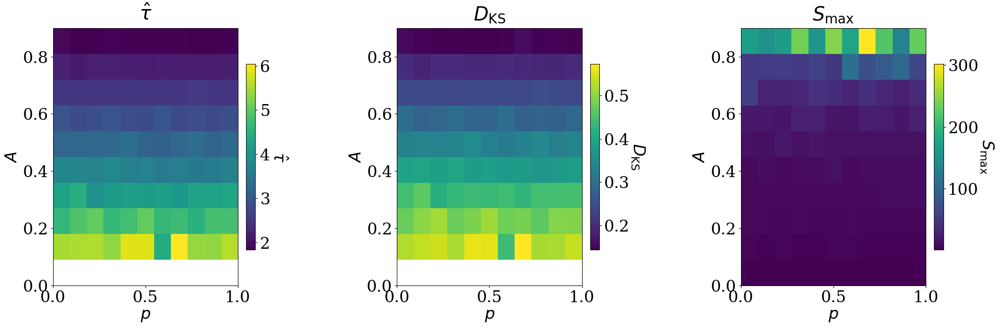
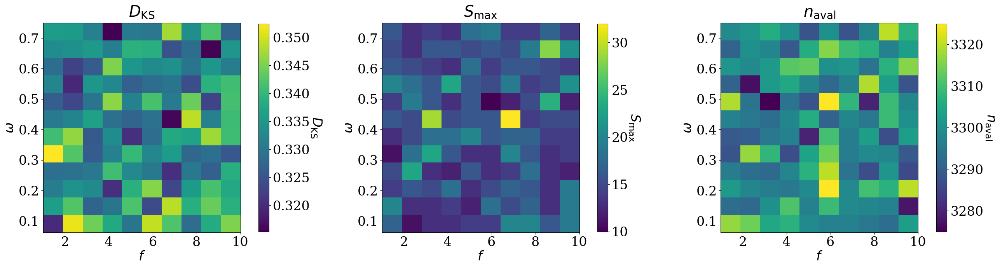
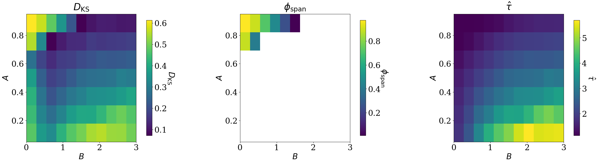
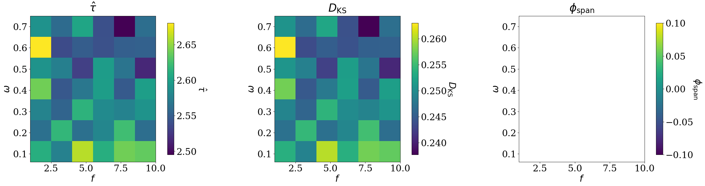
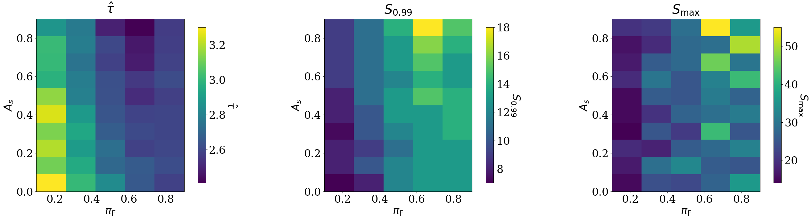
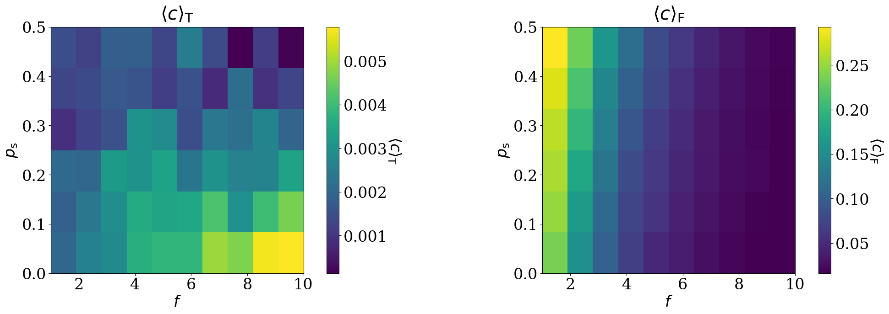

# Resonance or Resistance

**A Dynamical Model of Dual-Process Contagion and System Criticality**  
Senior Honours Research Project · University of St Andrews · 2026

**Highly Commended for the Duncan Prize (2026)** — University of St Andrews

*Recognised by the School of Mathematics & Statistics assessors for an outstanding Senior Honours research project. The Duncan Prize recognises the best written project in Mathematics or Statistics.*

*The full honours report is available upon request.*

## Research overview

Can socially mediated activation amplify cascade risk, or can it dampen the threshold-based dynamics of an interacting system? This project investigates that question using stochastic agent-based simulations on networks, with a stylised financial-market interpretation. It compares threshold-driven avalanches on static and adaptive networks with a second, probabilistic activation channel representing **fear of missing out (FOMO)**—activation in response to neighbouring activity rather than an internal threshold crossing.

The model is a **mechanism-based investigation of regimes**, not a calibrated financial forecasting system.

## Research abstract

Modern financial markets exhibit intermittent and extreme fluctuations driven by internal interaction dynamics rather than external shocks. Observed features such as volatility clustering, abrupt regime shifts, and coordinated trading episodes challenge traditional equilibrium frameworks, motivating interaction- and contagion-based modelling approaches. While self-organised criticality (SOC) provides a natural lens for analysing such dynamics, existing SOC-based market models typically rely on static networks, homogeneous agents, and single contagion mechanisms, thereby limiting their applicability to contemporary markets, which are characterised by adaptive interaction structures and socially mediated coordination.

This work develops an agent-based framework that integrates SOC dynamics with temporal network structure and socially mediated activation. The model progresses from a traditional threshold-based system to one incorporating a secondary probabilistic contagion mechanism that captures fear of missing out (FOMO)-driven behaviour. The central objective is to determine whether FOMO-driven behaviour induces *resonance*, amplifying systemic fragility, or *resistance*, dampening pre-existing cascade dynamics.

Simulation results show that, in traditional settings, redistribution strength governs critical behaviour while cascades remain bounded in size. However, the introduction of FOMO-driven contagion produces a qualitative regime shift: system-spanning cascades emerge, scaling relations break down in an identifiable sub-region (while remaining SOC-consistent elsewhere), and influence becomes increasingly concentrated in a small, unstable subset of agents. In multilayer settings, these effects persist even when global cascade statistics remain bounded: cross-layer interaction generates asymmetric dominance, with one agent type systematically capturing influence, alongside rising inequality. A central finding is that, in the multilayer system, cascade magnitude and influence concentration decouple: dominance accumulates without extreme cascades.

These findings indicate that socially mediated contagion does not stabilise markets but amplifies and redistributes fragility, both through extreme events and through gradual structural reorganisation. The framework, therefore, provides a mechanism-based approach to identifying regimes of endogenous systemic risk, bridging classical SOC theory with the behavioural and structural features of modern financial systems.

## Included experiments

| Report phase | Experiment | Implementation | Outputs |
| --- | --- | --- | --- |
| **I.S** | Traditional threshold contagion on a static rewired network | [`src/phase_i_s_static_sweep.py`](src/phase_i_s_static_sweep.py) | [`results/phase_i_s/`](results/phase_i_s/) |
| **I.D** | Threshold contagion with adaptive network rewiring | [`src/phase_i_d_dynamic_sweep.py`](src/phase_i_d_dynamic_sweep.py) | [`results/phase_i_d/`](results/phase_i_d/) |
| **II.S** | Dual-mechanism threshold and probabilistic contagion on a static network | [`src/phase_ii_s_dual_contagion_sweep.py`](src/phase_ii_s_dual_contagion_sweep.py) | [`results/phase_ii_s/`](results/phase_ii_s/) |

**Phase I.S — Static traditional network.** Establishes the baseline behaviour of the model by varying network topology and information redistribution strength. Avalanche statistics are analysed to identify parameter regimes consistent with self-organised criticality and provide a reference for subsequent experiments.

**Phase I.D — Dynamic traditional network.** Extends the baseline by allowing network connections to change over time. The experiments investigate how adaptive rewiring influences avalanche statistics and network structure, isolating structural effects from those of additional contagion mechanisms.

**Phase II.S — Static dual contagion.** Introduces a secondary probabilistic activation mechanism representing fear of missing out (FOMO), alongside traditional threshold-based contagion. Parameter sweeps investigate whether the interaction of these mechanisms amplifies or suppresses cascades and produces qualitatively different dynamical regimes.

**Stability and robustness.** Stability analyses were conducted across the research phases to assess the consistency of the observed behaviour. The repository includes the stability results for Phase I.S; the remaining stability analyses were omitted to keep the public repository focused on the principal experiments and findings.


## Selected figures

**Phase I.S — Scaling behaviour under variation in redistribution and topology**



**Phase I.D — The influence of dynamic rewiring on cascade statistics**



**Phase II.S — Static dual-contagion regime behaviour**



### Further research highlights

The wider study also investigated adaptive dual contagion and interacting networks. The figures below illustrate the progression beyond the three released simulation programs.

**Phase II.D — Cascade diagnostics with adaptive dual contagion**



**Phase III.S — Cascade diagnostics in static interacting networks**



**Phase III.D — Clustering dynamics in interacting adaptive networks**



*The later-phase figures are selected research illustrations; the corresponding source implementations are not included.*

## Parameters and observables

| Symbol / code | Interpretation |
| --- | --- |
| `N` | Side length of the square lattice (`N × N` agents) |
| `T` | Number of simulation time steps |
| `p` | Initial structural rewiring probability |
| `A` | Fraction of information redistributed upon threshold activation |
| `f` | Number/frequency of adaptive rewiring updates in Phase I.D |
| `TH` (ω in report and figures) | Edge-use threshold controlling rewiring in Phase I.D |
| `B` | Sensitivity of the probabilistic activation mechanism in Phase II.S |
| `s_min` | Lower avalanche-size threshold used for tail estimation |

### Key measured observables

| Symbol (report) | CSV / code label | Interpretation |
| --- | --- | --- |
| $S$ | `size` / avalanche-size records | Number of distinct agents activated in an avalanche |
| $\hat{\tau}$ | `tau_hat` | Estimated avalanche-size tail exponent |
| $D_{KS}$ | `ks` | Kolmogorov–Smirnov distance for the fitted distribution |
| $\eta_{tail}$ | `n_tail` | Number of avalanches in the fitted tail |
| $S_{0.99}$ | `size_p99` | 99th percentile avalanche size |
| $S_{max}$ | `size_max` | Largest observed avalanche |
| $\phi_{span}$ | `frac_system_spanning` | Fraction of system-spanning avalanches |
| $\kappa$ | `kappa` (when recorded) | Spikiness: relative dominance of extreme events |

**Reading the later-phase figures.** The heatmap headings use the mathematical symbols from the dissertation: $\hat{\tau}$ is the fitted avalanche-tail exponent; $D_{KS}$ is the Kolmogorov–Smirnov distance between the empirical and fitted distributions (**smaller indicates a closer fit**); $\phi_{\mathrm{span}}$ is the fraction of system-spanning avalanches; $S_{0.99}$ and $S_{\max}$ are the 99th-percentile and maximum avalanche sizes. In the Phase III.D figure, $\langle c\rangle_T$ and $\langle c\rangle_F$ are the **mean local clustering coefficients** within the traditional ($T$) and FOMO ($F$) network layers, respectively; higher values indicate stronger local clustering. Axis labels include $f$ (rewiring frequency), $\omega$ (rewiring threshold), $p_s$ (cross-layer connection probability), $A_s$ (cross-layer redistribution strength), and $\pi_F$ (proportion of F-layer agents). Heatmap colours represent the value of the quantity named above each panel, not a universal scale.

Not every observable appears in every CSV. See the [parameter and output glossary](docs/PARAMETERS_AND_OUTPUTS.md) for the notation used in the later-phase panels.


## Running the simulations

**Environment.** The research report specifies Python 3.12 with NumPy, NetworkX, SciPy, Matplotlib, scikit-learn, python-louvain, and tqdm in the broader project. The included scripts import a subset; see [`requirements.txt`](requirements.txt). Exact historical dependency versions were not recorded, so the environment is not claimed to be bit-for-bit reproducible.

From the repository root, in an appropriately configured Python environment:

```bash
python -m pip install -r requirements.txt
python src/phase_i_s_static_sweep.py
python src/phase_i_d_dynamic_sweep.py
python src/phase_ii_s_dual_contagion_sweep.py
```

**Caution:** These are full parameter sweeps and may be computationally expensive.

Phase I simulations were performed locally. As the research expanded, simulations were migrated to university's HPC resources. The included Phase II.S SLURM launcher is in [`hpc/`](hpc/); cluster-specific partition, environment and scheduling configuration must be adapted to the destination system.

## Data and reproducibility notes

- The included CSV files are historical simulation exports; the supplied figures were not regenerated from the released scripts during repository preparation.
- **Tail-fit cutoff:** the original Phase I.S extended sweep CSV was calculated with $S_{min}=1$, whereas the current source uses $S_{min}=2.5$. The dissertation compared $S_{min}=2.5$ with $6.25$ on the baseline and found consistent fitted exponents where both cutoffs had sufficient tail data; this does not make the original extended-sweep CSV an exact output of the updated source.
- Power-law-compatible fits are comparative diagnostics, not proof that SOC is the unique mechanism or that the model predicts real market outcomes.
